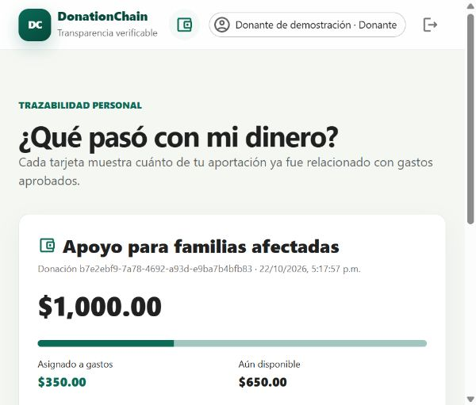

# DonationChain

Plataforma web para seguir el origen y uso de donaciones. Una persona puede consultar cuánto recibió una campaña, qué gastos fueron aprobados, qué comprobante respalda cada movimiento y si el archivo conserva su huella SHA-256.

El proyecto evolucionó desde una simulación de escritorio hacia un piloto con API, base de datos, usuarios, roles, comprobantes reales, auditoría y un Smart Contract preparado para Ethereum Sepolia.



## Funcionalidades

- Organizaciones, usuarios y campañas persistentes.
- Roles de administrador, organización, donante y auditor.
- Montos exactos con `Decimal`; nunca se usa `float` para dinero.
- Registro de donaciones y solicitud de gastos.
- Aprobación o rechazo independiente de gastos.
- Asignación automática FIFO que indica qué donaciones financiaron cada gasto.
- Carga de comprobantes PDF, PNG o JPEG con límite de 10 MB.
- Verificación posterior del SHA-256 de un comprobante.
- Historial público por campaña y saldos recaudado, utilizado y disponible.
- Acuse PDF descargable para cada donación, con folio y evidencia criptográfica.
- Cadena de auditoría local enlazada mediante hashes.
- Controles para anclar y verificar evidencia mediante un Smart Contract en Sepolia.
- Pruebas integrales, análisis estático y auditorías de dependencias.

## Arquitectura

```text
frontend/   React + TypeScript + Vite + Material UI
backend/    Python 3.13 + FastAPI + SQLAlchemy + SQLite/PostgreSQL
contracts/  Solidity + Hardhat 3 + viem
legacy/     Simulación original en Tkinter
docs/       Arquitectura, seguridad y despliegue
```

Los comprobantes y los datos personales no se guardan en Blockchain. El contrato conserva únicamente identificadores y hashes. Consulta [la arquitectura](docs/ARQUITECTURA.md) para ver el flujo completo.

## Inicio rápido en Windows

Requisitos:

- Python 3.13.
- Node.js 22.13 o posterior.
- PowerShell.

### Opción sencilla

Después de descargar o clonar el repositorio, abre la carpeta y haz doble clic en:

```text
run.bat
```

El archivo prepara automáticamente las dependencias la primera vez, crea una configuración local segura, inicia la API y la página en dos ventanas y abre `http://127.0.0.1:5173`.

Las cuentas de prueba utilizan inicialmente la contraseña `Donation123!`. La configuración permanece únicamente en `backend/.env` y Git no la sube.

En Git Bash, Linux o macOS se puede usar:

```bash
bash run.sh
```

No es necesario compilar ni desplegar el Smart Contract para ejecutar el piloto local.

### Opción manual

Instala las dependencias:

```powershell
./setup.ps1
```

Copia `backend/.env.example` como `backend/.env` y reemplaza, como mínimo:

```env
JWT_SECRET=una-cadena-aleatoria-larga
DEMO_PASSWORD=una-contrasena-local-segura
```

Inicia la API:

```powershell
./start-backend.ps1
```

En otra terminal inicia la página:

```powershell
./start-frontend.ps1
```

Abre `http://localhost:5173`. La documentación interactiva de la API está en `http://127.0.0.1:8000/docs`.

## Cuentas del piloto

Cuando `ENVIRONMENT=development` y existe `DEMO_PASSWORD`, el sistema crea:

| Rol | Correo |
|---|---|
| Administrador | `admin@donationchain.example.com` |
| Organización | `organizacion@donationchain.example.com` |
| Auditor | `auditor@donationchain.example.com` |
| Donante | `donante@donationchain.example.com` |

Todas usan exclusivamente la contraseña local definida en `DEMO_PASSWORD`. Estas cuentas no deben habilitarse en producción.

## Smart Contract y Proof of Stake

`contracts/contracts/DonationTraceability.sol` registra:

- hash del identificador de la evidencia;
- hash de los datos auditados;
- tipo de registro;
- fecha del bloque;
- dirección autorizada que escribió;
- URI lógica sin información personal.

Ethereum utiliza Proof of Stake y Sepolia es su red de prueba recomendada para aplicaciones. DonationChain usa ese consenso existente: no implementa una minería ni un “Proof of State” propio.

La pantalla de auditoría permite que el administrador envíe una entrada al contrato y que posteriormente se compare el hash local contra el hash almacenado en Sepolia. La vista del donante muestra el estado del anclaje, la transacción y una verificación directa cuando el contrato está configurado.

La API ya puede consultar Sepolia. Para desplegar y habilitar escrituras hacen falta una cartera separada, ETH de prueba y variables privadas. Sigue [la guía del piloto](docs/DESPLIEGUE_PILOTO.md). Nunca subas una clave privada a GitHub.

El contrato de demostración actual está desplegado en Sepolia en [`0x5c1F526eff76983ade86D6981c23d7b9D8E6d597`](https://sepolia.etherscan.io/address/0x5c1F526eff76983ade86D6981c23d7b9D8E6d597). La API local quedó preparada para anclar y verificar hashes contra este contrato sin almacenar comprobantes ni datos personales en la cadena.

## Comprobante del donante

En **Mi dinero**, cada donación permite descargar un acuse PDF con folio, campaña, organización, monto, fecha, hash de auditoría y estado Blockchain. Mientras no exista una pasarela de pagos, el documento se identifica expresamente como acuse de registro de demostración: no es un recibo fiscal ni confirma por sí solo una transferencia bancaria.

## Pruebas

Ejecuta todo con:

```powershell
./test-all.ps1
```

La suite comprueba, entre otros casos:

- conservación exacta de centavos;
- rechazo de más de dos decimales;
- permisos y autenticación;
- rechazo de archivos falsos y rutas peligrosas;
- prevención de gastos sin saldo;
- aprobación y asignación de fondos;
- integridad de la auditoría;
- autorización y registros duplicados en el contrato.

Revisa [los controles y límites de seguridad](docs/SEGURIDAD.md) antes de exponer el piloto a usuarios reales.

## Alcance actual

Este repositorio contiene un piloto funcional, no un sistema financiero certificado. El hash prueba integridad después del registro, pero no prueba por sí solo que una transferencia bancaria, una factura o la información proporcionada sean verdaderas. Para producción todavía se requiere conciliación bancaria, verificación legal/fiscal, PostgreSQL administrado, almacenamiento privado, MFA, monitoreo y auditoría externa del contrato.

## Proyecto académico

Materia: Cadena de Bloques, Ingeniería en Informática.

Autores: Diego Flores Murillo y Diego Alexis Galván Roldán.
